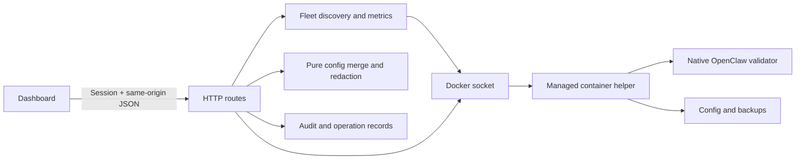

# Architecture

ClawDeck uses Node.js core APIs at runtime and plain browser modules. The dashboard speaks a same-origin JSON API; the server talks to the local Docker Engine over its socket. There is no database server and no hosted control plane.

## Module boundaries

| Area                         | Responsibility                                                                                     |
| ---------------------------- | -------------------------------------------------------------------------------------------------- |
| `server.mjs`                 | Session lifecycle, route orchestration, instance locks and outcome handling.                       |
| `lib/http.mjs`               | Bounded JSON bodies, UTF-8 validation, response helpers and origin checks.                         |
| `lib/fleet.mjs`              | Short-lived snapshot cache and bounded parallel collection.                                        |
| `lib/docker.mjs`             | Docker API negotiation, socket transport, exec and log framing.                                    |
| `lib/config-core.mjs`        | Pure redaction, editable scopes, secret restoration and diffs.                                     |
| `lib/config.mjs`             | Production SHA-256 revision calculation and pure helper exports.                                   |
| `lib/container-helper.cjs`   | In-container config discovery, native validation, conflict checks, backups and atomic replacement. |
| `lib/operations.mjs`         | Serialized idempotency reservations and durable results.                                           |
| `lib/audit.mjs`              | Bounded in-memory events and serialized rotating JSONL writes.                                     |
| `public/editor.js`           | Draft field merge and response generation gate.                                                    |
| `scripts/offline-runtime.js` | Demo-only in-memory API using the shared config transformations.                                   |

## Mutation sequence

Authenticate, verify same-origin intent, inspect the actual container and check its management label. Reserve an idempotency key durably, then lock that instance. For a configuration change, read the current revision, merge only supported sections and restore unchanged secret markers. The container helper locks the config, runs native validation, rechecks the revision, creates a backup and renames the candidate into place.

Report definite failures separately from uncertain results after submission. Once a mutation succeeds, an audit or result-persistence failure becomes a warning, not a claim that the mutation failed. Interrupted persisted operations recover as unknown. Reservation/pruning is serialized so concurrent requests cannot both own an operation ID.

Records retain completed operations for 24 hours and cap pending/current records at 1,000. The list is sorted by timestamp after restart. The data directory has one owner; this is not a distributed locking mechanism.

## Demo and website

esbuild bundles the real UI and an in-memory API into `preview.html`. Production configuration hashing stays on the server; the demo has its own non-security revision marker. No source-code stripping is used to assemble the demo. The static bilingual website links to this bundle and publishes no administrative API.

## Boundaries

Native config validation is not a provider connectivity test. External writers can still race the final revision-check-to-rename interval. The Docker socket remains host-privileged. Log redaction is heuristic. The project intentionally does not implement multi-host scheduling, shared encrypted secrets, RBAC or SSO.
